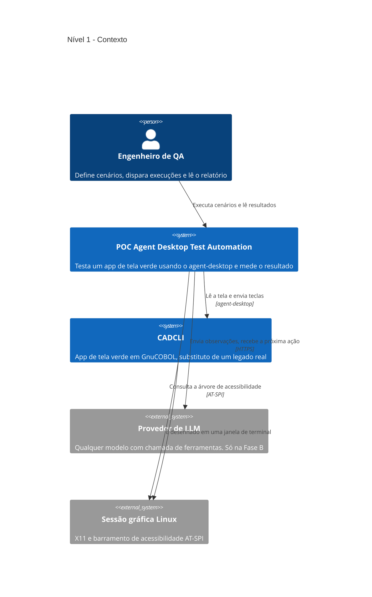
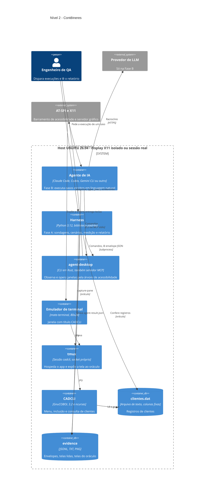
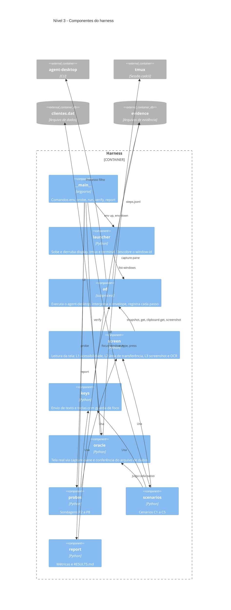
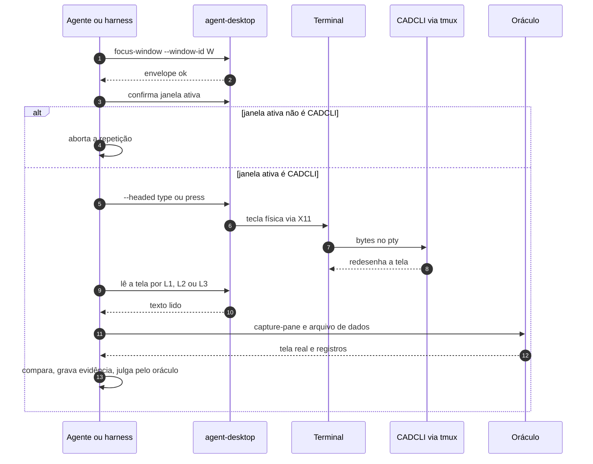
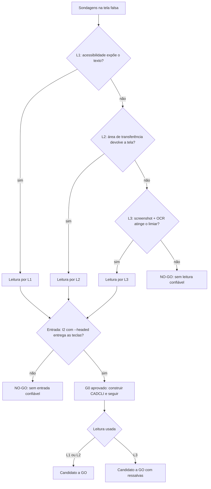
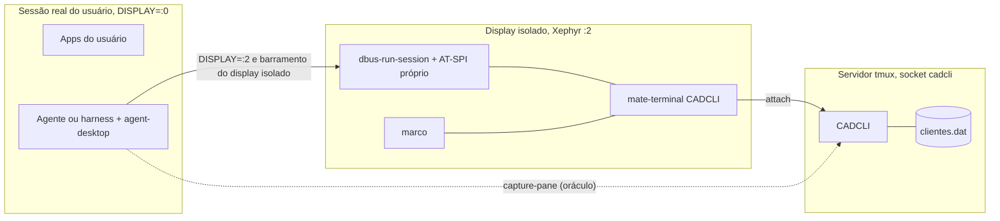

# ARCH — Arquitetura da POC

Versão 0.1 · 2026-11-11 · Modelo C4 em Mermaid. Detalhes de implementação em [SPEC-TECH.md](SPEC-TECH.md).

## Nível 1 — Contexto

## Nível 2 — Contêineres

Há dois caminhos até o app, e a separação é proposital:

- **Caminho sob teste:** agente ou harness → `agent-desktop` → AT-SPI/X11 → terminal → tmux → CADCLI.
- **Caminho do oráculo:** harness → tmux e arquivo de dados, sem passar pelo `agent-desktop`.

## Nível 3 — Componentes do harness

## Fluxo de um passo de teste

## Escolha das estratégias

## Implantação

O display isolado é o padrão proposto e ainda precisa ser validado (sondagem P8). Se o `agent-desktop` não funcionar nele, tudo roda na sessão real e a guarda de foco passa a ser a única proteção.

## Decisões de arquitetura

| # | Decisão | Motivo | Alternativa descartada |
|---|---|---|---|
| A1 | Sondar com tela falsa antes de escrever o app | A pergunta central pode ter resposta negativa em uma hora de trabalho | Construir tudo e descobrir no fim |
| A2 | Oráculo fora do caminho sob teste (tmux + arquivo) | O agente não pode julgar o próprio sucesso; mede fidelidade de leitura com precisão | Confiar no que o `agent-desktop` leu |
| A3 | Duas fases: determinística, depois com IA | Separa falha da ferramenta de falha do modelo | Só rodar com IA |
| A4 | Display isolado como padrão | Entrada física não toma o teclado nem atinge outros apps | Rodar direto na sessão real |
| A5 | Harness em Python, só biblioteca padrão | Já instalado, sem dependências | Bash + jq (frágil para medir); framework de testes externo |
| A6 | Dados em arquivo de texto de colunas fixas | Oráculo e reset triviais | Arquivo indexado (depende do build do GnuCOBOL) |
| A7 | Casos da Fase B em Markdown, agente fala CLI ou MCP | Qualquer IA executa | Prender a POC a um SDK de agente |
